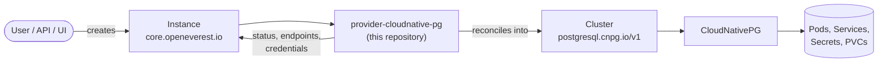

# CloudNativePG Provider

> [!WARNING]
> **Pre-alpha.** OpenEverest v2 and this provider are under active development. CRD schemas,
> chart values and defaults change frequently, including in breaking ways, and there is no
> supported upgrade path between versions yet. Not for production use.

[](https://github.com/openeverest/openeverest)
[](https://github.com/AdityaPimpalkar/provider-cloudnative-pg/actions/workflows/build.yaml)
[](https://github.com/AdityaPimpalkar/provider-cloudnative-pg/releases)
[](https://pkg.go.dev/github.com/adityapimpalkar/provider-cloudnative-pg)
[](LICENSE)

Run **PostgreSQL** on Kubernetes through
[OpenEverest](https://github.com/openeverest/openeverest), backed by
[CloudNativePG](https://cloudnative-pg.io/).

## What this is

OpenEverest providers translate a single, technology-agnostic `Instance` custom resource into
the native custom resources of an upstream Kubernetes operator — for databases, but equally
for caches, message queues, object storage, or model-serving runtimes. This repository is the
provider for **PostgreSQL via CloudNativePG**: it owns the technology-specific knowledge —
topologies, versions, parameters, backup wiring — so that users, the API server, and the UI
stay technology-agnostic.

> [!IMPORTANT]
> **This provider is not standalone.** It requires an OpenEverest installation (core CRDs and
> controller) in the cluster. Installing this chart on its own does nothing.
> See [Install OpenEverest](https://openeverest.io/documentation/current/quick-install.html).



The provider watches `Instance` resources whose `spec.providerRef.name` is
`provider-cloudnative-pg`, and reports workload health back onto `Instance.status`. It never
manages pods directly — all lifecycle work is delegated to the operator.

## Compatibility

| provider-cloudnative-pg | OpenEverest | CloudNativePG | Kubernetes |
|---|---|---|---|
| `0.2.x` | `2.0.0-dev.2` | `1.29.x` | `1.30` – `1.34` |
| `main` | `2.0.0-dev.4` | `1.30.x` | `1.34` – `1.36` |

## Capabilities

What you can do to a running instance through the `Instance` API. Upgrading the
provider itself is covered under [Installation](#installation).

| Capability | Status | Notes |
|---|---|---|
| Provisioning | ✅ | |
| Horizontal scaling | ✅ | `spec.components.engine.replicas` |
| Vertical scaling (CPU / memory) | ✅ | `spec.components.engine.resources` |
| Version upgrades | ✅ | of the deployed PostgreSQL version — change `spec.version`; see [Versions](#versions) |
| Custom configuration | ✅ | PostgreSQL GUCs via `spec.components.engine.parameters.postgresql` |
| Bootstrap (`initdb`) | ✅ | database name, owner, and credentials secret |
| Managed roles | ✅ | CloudNativePG managed roles with readiness gating in `Status()` |
| TLS-only connections | ✅ | `parameters.requireTLS: true` rejects unencrypted client connections; see [Require TLS](#require-tls) |
| Pod scheduling | ✅ | `spec.components.engine.schedulingPolicy` (all fields), or `parameters.affinity` — not both |
| Pod priority | ✅ | `parameters.priorityClassName` → CloudNativePG `spec.priorityClassName`; the PriorityClass must exist, and changing it rolls the instance pods |
| Monitoring | ✅ | Prometheus: a PodMonitor for the instance pods via `spec.topology.parameters.monitoring.prometheus`; requires the Prometheus Operator. See [Scrape metrics with Prometheus](#scrape-metrics-with-prometheus) |

### Extensions

First-class toggles under `spec.components.engine.parameters.extensions.<name>.enabled`. The
provider runs `CREATE EXTENSION` for each enabled one in the application database through a
single CNPG `Database` resource (`<instance>-extensions`). Extensions not in the `standard`
operand images are mounted as image volumes: these need PostgreSQL **18** and Kubernetes
ImageVolume (1.35+, or 1.33/1.34 + feature gate), and adding one restarts the instances.

The image-volume images come from a CloudNativePG `ClusterImageCatalog` that the chart renders
from `extensionCatalog` in its values (default: the official CloudNativePG trixie builds plus
AGE, pinned by digest). The provider copies the catalog entry of each enabled extension (image,
paths, env) into the Cluster and passes the `sqlVersion` value to `CREATE EXTENSION`, so admins
can bump or mirror images with `helm upgrade`, or set `extensionCatalog.create=false` and point
`extensionCatalog.name` at a catalog they manage (the SQL versions go in
`sql-version.extensions.openeverest.io/<major>.<name>` annotations), without upgrading the
provider. A new image restarts the instances that use it.

| Extension | Toggle | Status | Enable on a running instance | Disable | Notes |
|---|---|---|---|---|---|
| pgvector | `pgvector` | ✅ | ✅ no restart | ❌ | PG 14–18, bundled in the `standard` images: no image change. See [examples/instance-pgvector.yaml](examples/instance-pgvector.yaml) |
| pgAudit | `pgaudit` | ✅ | ✅ restarts | ✅ the operator drops it | PG 14–18, bundled; sets `pgaudit.log: "ddl, role"` unless a value is set in `postgresql.parameters`, and the operator then preloads it and creates it in every database |
| TimescaleDB OSS | `timescaledb` | ✅ | ❌ creation only ¹ | ❌ | Image volume, preloaded. See [examples/instance-timescaledb.yaml](examples/instance-timescaledb.yaml) |
| PostGIS | `postgis` | ✅ | ✅ restarts | ❌ | Image volume |
| pgRouting | `pgrouting` | ✅ | ✅ restarts | ❌ | Image volume; requires `postgis` |
| pg_ivm | `pgivm` | ✅ | ❌ creation only ¹ | ❌ | Image volume, preloaded |
| wal2json | `wal2json` | ✅ | ✅ restarts | ✅ restarts | Image volume; a logical decoding output plugin (no `CREATE EXTENSION`) — drop the replication slots that use it before disabling |
| Apache AGE | `age` | ✅ | ❌ creation only ² | ❌ | Image volume from [solanicaio/postgresql-extensions](https://github.com/solanicaio/postgresql-extensions), preloaded. Run `SET search_path = ag_catalog, "$user", public` before using it |

Extensions that are created in the database (everything but pgAudit and wal2json) cannot be
disabled: dropping them would fail or destroy data, so the provider rejects it.

¹ Enforced by the provider: CloudNativePG advises against rolling out a new extension image and a
`shared_preload_libraries` change together, and enabling them on a running instance does exactly
that.

² Enforced by the provider: the application owner gets `USAGE` on `ag_catalog` through default
privileges set in `postInitApplicationSQL`, which only runs at bootstrap. Default privileges on
schemas cannot be limited to one schema, so the owner also gets `USAGE` on any other schema the
`postgres` superuser creates later in the application database.

Stateful workloads additionally report:

| Capability | Status | Notes |
|---|---|---|
| Persistent storage | ✅ | `spec.components.engine.storage` |
| Storage expansion | ✅ | when the StorageClass allows volume expansion (`resizeInUseVolumes`) |
| Backups (on demand) | ✅ | operator-native (`executionMode: ProviderManaged`) via the Barman Cloud Plugin; one backup storage per Instance (CNPG supports a single WAL archive) |
| Restore | ✅ | from a succeeded Backup via Barman |
| Scheduled backups | ✅ | `spec.backup.storages[].schedules` → CNPG `ScheduledBackup`; mirrored as OpenEverest `Backup` CRs |
| Schedule retention | ✅ | time-based recovery windows are delegated to CNPG/Barman via ObjectStore retentionPolicy; count-based retention is rejected |
| Backup deletion | ✅ | `deletionPolicy: Delete` removes the Barman base backup; `Retain` removes only the CNPG Backup resource |
| PITR | ✅ | restore to a point in time via `spec.dataSource` |

CNPG retention uses the Barman Cloud Plugin's native recovery window:

```yaml
retention:
  type: time
  duration: 30d
```

All schedules targeting the same storage, including disabled schedules, must
specify the same duration or all omit retention (keep all). The window applies
to that cluster's entire Barman archive, including on-demand backups and WAL,
not independently to each schedule. Barman preserves the base backup needed to
recover from the beginning of the window. Count retention is not supported.
The OpenEverest dev.4 schedule form edits only count retention ("retention
copies"), which this provider rejects. Leave copies at 0 and set time retention
through the API or CLI.
`deletionPolicy: Retain` skips explicit data deletion; it does not exempt a
backup from Barman's archive-wide retention policy.
If CNPG removes a backup resource during native catalog cleanup, its Everest
record is reported as failed/unavailable rather than starting a replacement backup.

`deletionPolicy: Delete` runs a one-off `barman-cloud-backup-delete` Job
(`delete-backup-<name>`) for the backup's Barman ID. The Job meets the
restricted Pod Security Standard. Backups that never received a Barman ID
(not started, or failed early) have no data to delete. If the Job fails, inspect
its logs and delete the Job to retry. Data deletion runs only while the source
Instance exists; delete Backups before deleting their Instance.

The backup integration suite checks native policy configuration, not the
passage of a multi-day recovery window.

## Installation

The provider chart is published as an OCI artifact:

```bash
helm install provider-cloudnative-pg \
  oci://ghcr.io/adityapimpalkar/charts/provider-cloudnative-pg \
  --version 0.3.2 \
  --namespace everest-system
```

- The CloudNativePG operator and the Barman Cloud Plugin (and their CRDs) are bundled as chart
  dependencies and are installed automatically. Set `cloudnative-pg.enabled=false` or
  `plugin-barman-cloud.enabled=false` to use externally managed installs instead.

> [!IMPORTANT]
> The Barman Cloud Plugin's admission webhooks require [cert-manager](https://cert-manager.io)
> to be installed in the cluster before installing this chart (when the plugin subchart is
> enabled).

Upgrade and uninstall:

```bash
helm upgrade provider-cloudnative-pg \
  oci://ghcr.io/adityapimpalkar/charts/provider-cloudnative-pg --version 0.3.2
helm uninstall provider-cloudnative-pg --namespace everest-system
```

Uninstalling the chart does **not** delete running `Instance` resources or their data.

## Usage

Verify that the provider registered itself:

```bash
kubectl get providers.core.openeverest.io provider-cloudnative-pg
```

Create an instance:

```yaml
apiVersion: core.openeverest.io/v1alpha1
kind: Instance
metadata:
  name: my-instance
spec:
  providerRef:
    name: provider-cloudnative-pg
  version: "17.10"
  components:
    engine:
      type: postgresql
      replicas: 3
      resources:
        requests:
          cpu: "1"
          memory: 1Gi
        limits:
          cpu: "1"
          memory: 1Gi
      storage:
        size: 5Gi
```

Component names are defined by this provider — see [definition/provider.yaml](definition/provider.yaml).
`spec.version` and `spec.topology` are optional; the provider defaults apply.
More examples live in [examples/](examples/), including
[TimescaleDB](examples/instance-timescaledb.yaml) and [pgvector](examples/instance-pgvector.yaml).

Watch it come up and read the connection details:

```bash
kubectl get instance my-instance -w
kubectl get instance my-instance -o jsonpath='{.status.connectionSecretRef.name}'
```

The credentials (host, port, username, password, uri) live in the connection
Secret named by `.status.connectionSecretRef.name`.

### Scrape metrics with Prometheus

Every CloudNativePG instance pod serves its metrics exporter on port `metrics` (9187).
With the [Prometheus Operator](https://prometheus-operator.dev/) in the cluster, enable
Prometheus (the **Monitoring → Prometheus** toggle in the UI) to get a PodMonitor
(`<instance>-metrics`) that scrapes it, over HTTPS when
`spec.components.engine.parameters.monitoring.tls.enabled` is set. `podMonitorLabels` lets
your Prometheus `podMonitorSelector` pick it up. Turning it off removes the PodMonitor.

```yaml
spec:
  topology:
    type: replicaSet
    parameters:
      monitoring:
        prometheus:
          enabled: true
          podMonitorLabels:
            release: kube-prometheus-stack
```

The PodMonitor carries `app.kubernetes.io/managed-by=everest` and
`app.kubernetes.io/instance=<instance>`, which the OpenEverest metrics plugin uses to find it.
Don't combine it with CloudNativePG's deprecated `monitoring.enablePodMonitor`, which would
scrape every pod twice; the provider rejects that combination.

## Topologies

| Topology | Default | Description |
|---|---|---|
| `replicaSet` | ✅ | A CloudNativePG primary + standby cluster built from the `engine` component (default 3 instances) |

The `backupAgent` component is optional. Prometheus scraping is a topology
parameter (`spec.topology.parameters.monitoring.prometheus`), not a component.

## Versions

| Version bundle | Default | postgresql |
|---|---|---|
| `17.10` | ✅ | `17.10` (`ghcr.io/cloudnative-pg/postgresql:17.10-standard-trixie`) |
| `18.4` | | `18.4` |
| `16.14` | | `16.14` |
| `15.18` | | `15.18` |
| `14.23` | | `14.23` |

Source of truth: [definition/versions.yaml](definition/versions.yaml).

Images follow CloudNativePG recommended practice (official CNPG operands, `standard` image type
on Debian `trixie`). The operator must already support the target version — upgrade the
provider chart first.

## Configuration

- **Chart values:** [charts/provider-cloudnative-pg/values.yaml](charts/provider-cloudnative-pg/values.yaml)
- **Instance parameters:** per-component and per-topology `parameters` schemas, defined under
  [definition/](definition/) and published on the `Provider` resource
  (`kubectl get provider provider-cloudnative-pg -o yaml`). The API server and the UI validate
  user input against these schemas.

The technology-specific knobs worth knowing about:

| Parameter | Applies to | Purpose |
|---|---|---|
| `bootstrap.initdb` | `engine` | Initial database name, owner, and optional credentials Secret |
| `postgresql` | `engine` | Full CloudNativePG `PostgresConfiguration` (GUCs, sync replicas, …) |
| `extensions.*` | `engine` | First-class extensions; see [Extensions](#extensions). TimescaleDB also defaults `timescaledb.telemetry_level=off` and `max_locks_per_transaction=128` unless set in `postgresql.parameters` |
| `affinity` | `engine` | CloudNativePG `AffinityConfiguration`; rejected together with `schedulingPolicy` `affinity`, `nodeSelector` or `tolerations` |
| `managed` | `engine` | Managed PostgreSQL roles |
| `resizeInUseVolumes` | `engine` | Allow PVC expansion on running instances |
| `priorityClassName` | `engine` | Kubernetes PriorityClass of the instance pods |
| `certificates` | `engine` | TLS certificate configuration passthrough |
| `requireTLS` | `engine` | Reject unencrypted client connections; see [Require TLS](#require-tls) |
| `monitoring` | `engine` | CloudNativePG monitoring configuration (custom queries, metrics TLS, …) |
| `monitoring.prometheus` | topology | Create a PodMonitor for the instance; see [Scrape metrics with Prometheus](#scrape-metrics-with-prometheus) |

### Require TLS

CloudNativePG always serves TLS, but its default `pg_hba.conf` also accepts
unencrypted connections. Set `requireTLS: true` to refuse them:

```yaml
spec:
  components:
    engine:
      parameters:
        requireTLS: true
```

The provider places `hostnossl all all all reject` before any rules in
`postgresql.pg_hba`. CloudNativePG applies it with a configuration reload, so
instances are not restarted. Replication and local connections are unaffected:
CloudNativePG's own rules for them come first and use TLS or the local socket.

Clients must connect with TLS. libpq's default `sslmode=prefer` does;
`sslmode=disable` is refused. Use `sslmode=verify-full` with the cluster CA to
also authenticate the server.

The UI enables this by default for new instances. Unset means off, so existing
instances keep accepting unencrypted clients until you turn it on.

## Development

Requires Go (see [go.mod](go.mod)), Docker, Helm, kubectl, and a Kubernetes cluster you can
reach. [dev/README.md](dev/README.md) covers the environment end to end: the recommended
local k3d setup, running against a cluster you already have, and every `dev/.env` setting.

```bash
make dev-up             # local cluster + Tilt dev environment (see dev/README.md)
make generate           # RBAC, provider spec, Helm chart sync
make run                # run the provider locally against the cluster
make test               # unit tests
make test-integration   # chainsaw suites under test/integration/
make test-integration-backup # backup integration suite against S3Mock
make dev-down
```

To work against a cluster you already have — kind, GKE, a shared OpenEverest Tilt cluster —
skip `make dev-up` and point Tilt at it:

```bash
cp dev/.env.example dev/.env   # set K8S_CONTEXT, and DOCKER_REGISTRY_URL for a remote registry
tilt up -f dev/Tiltfile
```

`make help` lists every target. `make verify` fails when generated files are stale — run
`make generate` and commit the result.

The provider contract (`Validate` / `Sync` / `Status` / `Cleanup`), RBAC markers, watches,
code generation, and the backup/restore interfaces are documented once for all providers in
[PROVIDER_DEVELOPMENT.md](https://github.com/openeverest/provider-sdk/blob/main/PROVIDER_DEVELOPMENT.md).

### Layout

| Path | Purpose |
|---|---|
| `cmd/provider/` | Entry point |
| `internal/provider/` | `ProviderInterface` implementation, backup mirror, RBAC markers |
| `internal/cnpg/` | CloudNativePG helpers — TimescaleDB, roles; `barman/` for backup, restore, and schedules |
| `internal/common/` | Component name constants |
| `definition/` | Provider identity, component types, versions, topologies, backup classes |
| `charts/provider-cloudnative-pg/` | Helm chart (`generated/` is produced by `make generate`) |
| `config/rbac/role.yaml` | Generated `ClusterRole` — do not edit |
| `test/integration/` | Chainsaw suites: `core/replicaset`, `backup`, `extensions/bundled`, `extensions/imagevolume`, `tls-only` |
| `test/e2e-cluster/` | Chainsaw e2e suites on the full OpenEverest platform: `backup-restore` |
| `test/e2e/` | Playwright UI tests against the OpenEverest UI |
| `test/vars.sh` | Pinned versions used by tests |
| `examples/` | Example `Instance` resources |
| `dev/` | Tilt dev environment, `.env` configuration, k3d cluster config |
| `.github/workflows/` | CI: lint, build, unit and integration tests, release |

### Testing

- **Unit tests** — `make test`.
- **Integration tests** — chainsaw suites under [test/integration/](test/integration/).
  Individual suites are also exposed as make targets (`make test-integration-core`,
  `make test-integration-backup`, `make test-integration-core-replicaset`, `make test-integration-extensions`, …).
  The extension suites run a one-instance PostgreSQL and use each extension through `psql`.
  `extensions/imagevolume` needs Kubernetes ImageVolume (1.35+ with containerd 2.1+); the dev
  and CI k3d cluster ([dev/k3d_config.yaml](dev/k3d_config.yaml)) runs k3s 1.36, so
  `make test-integration` covers it (alone: `make test-integration-imagevolume`).
- **E2E cluster tests** — chainsaw suites under [test/e2e-cluster/](test/e2e-cluster/) that run
  user journeys on the full platform: the released OpenEverest core (server, controller and CRDs,
  at the version pinned in `go.mod`) installed by `make install-openeverest`, plus this provider.
  `backup-restore` writes data, takes a Backup, restores it into a new Instance through
  `spec.dataSource`, and checks the data. Run with `make test-e2e-cluster`.
- **E2E UI tests** — Playwright tests under [test/e2e/](test/e2e/) drive the OpenEverest UI: they
  create a PostgreSQL instance through the provider's generated form, wait for it to be Ready, and
  delete it. Run with `make test-e2e` (installs Chromium for Playwright) against a UI at `EVEREST_URL` (default
  `http://localhost:8080`, e.g. `kubectl -n everest-system port-forward svc/everest 8080:8080`);
  the test namespace defaults to `e2e-ui` (`E2E_NAMESPACE`) and must exist. Set
  `E2E_SKIP_KUBECTL=true` if the test host cannot reach the cluster API: the CNPG Cluster checks are
  then reported as skipped, and an instance left by a failed test is not deleted.
- **CI** — [.github/workflows/build.yaml](.github/workflows/build.yaml) runs lint, build, unit
  tests, generated-file verification, and Helm lint;
  [.github/workflows/test.yaml](.github/workflows/test.yaml) runs the integration suites;
  [.github/workflows/e2e-cluster.yaml](.github/workflows/e2e-cluster.yaml) runs the e2e cluster
  suites on every pull request; [.github/workflows/e2e.yaml](.github/workflows/e2e.yaml) runs the
  UI tests nightly, on demand, and on pull requests labelled `test/e2e`.

## Troubleshooting

```bash
kubectl logs -n everest-system deploy/provider-cloudnative-pg -f
```

| Symptom | Where to look |
|---|---|
| `Instance` stuck in `Creating` | `kubectl describe instance <name>` conditions, then the provider logs |
| No `Provider` resource in the cluster | Is the chart installed? Check the provider deployment logs |
| `Instance` ignored entirely | `spec.providerRef.name` must be `provider-cloudnative-pg` |
| `Cluster` created but not reconciled | Confirm CloudNativePG is running; for Barman, confirm cert-manager is installed |
| `Cluster` created but no pods | Inspect the CloudNativePG `Cluster` status — the failure is upstream in the operator |
| Backup / restore stuck | Check Barman plugin pods, `ObjectStore` / Backup CRs, and BackupStorage credentials |

## Contributing

Issues and pull requests are welcome. See
[PROVIDER_DEVELOPMENT.md](https://github.com/openeverest/provider-sdk/blob/main/PROVIDER_DEVELOPMENT.md)
and the [OpenEverest Code of Conduct](https://github.com/openeverest/openeverest/blob/main/CODE_OF_CONDUCT.md).

## Security

Report vulnerabilities per the [OpenEverest security policy](https://github.com/openeverest/openeverest/blob/main/SECURITY.md).
Please do not open public issues for security reports.

## License

Apache License 2.0 — see [LICENSE](LICENSE) for details.
